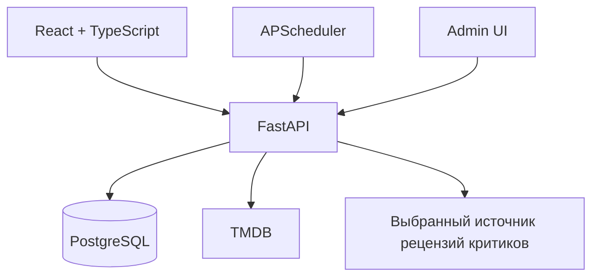

# Архитектура



Клиентская часть обращается только к серверной части. Сервер скрывает ключи внешних служб, нормализует их ответы, сохраняет данные и проверяет права доступа. TMDB используется для каталога фильмов. Англоязычные рецензии импортируются из NYT Article Search API; backend сохраняет текстовую выдержку и ссылку, без загрузки полного текста, изображений, оценок и вердиктов.

Внешние адреса и секретные ключи задаются в настройках окружения сервера. Не следует закреплять IP-адреса служб в приложении: поставщики могут менять адреса и использовать сети доставки содержимого.

При локальном запуске сервисы внутри Docker Compose связываются по именам служб; PostgreSQL использует внутренний порт `5432` и не должен открываться для внешних подключений. Браузер обращается к адресу backend, заданному в настройках клиентской части. Для TMDB серверу нужно исходящее HTTPS-соединение (порт `443`). Точный адрес backend и опубликованные локальные порты зависят от конфигурации запуска.

## Структура

```text
backend/
  app/
  migrations/
  tests/
  requirements.txt
  .env.example
frontend/
  src/
  public/
  package.json
docs/
docker-compose.yml
README.md
.gitignore
```

## Технологии

- Backend: Python 3.13, FastAPI, SQLAlchemy 2, Alembic, Pydantic, HTTPX, APScheduler, pytest.
- Frontend: React, TypeScript, Vite, React Router, Axios, Context API, CSS Modules или CSS.
- Данные: PostgreSQL в общем проекте Supabase либо локальный PostgreSQL в Docker Compose. Доступ к общей базе выполняет backend через Session pooler на порту 5432 с SSL. Таблицы приложения находятся в отдельной схеме `movie_service`; Supabase Auth и Data API для прикладных операций не используются.

## Модули

Авторизация выдаёт короткий access JWT (30 минут, claims sub/sid/iat/exp) и непрозрачный refresh. Сессии в PostgreSQL живут фиксированные 7 дней, refresh хранится хешированным и ротируется под блокировкой строки сессии. История использованных хешей позволяет отозвать сессию при повторном предъявлении. Общая зависимость проверяет активность пользователя и сессии для каждого защищённого запроса. HttpOnly cookie используется только для получения/отзыва токенов; остальные ручки требуют Bearer. Специальный заголовок и разрешённый Origin защищают auth cookie-операции от CSRF. Для развёртывания frontend/backend используются один origin и HTTPS; локальный Vite проксирует `/api`. AUTH_COOKIE_SECURE=true обязателен в production. Архитектура не требует Redis или внешнего провайдера авторизации.

`auth`, `users`, `movies`, `lists`, `ratings`, `reviews`, `friendships`, `critic_reviews`, `admin`.

Модуль `users` предоставляет просмотр и частичное изменение профиля, историю оценок и список рецензий пользователя. Общий SQL-предикат в `profile_repository` разрешает чтение содержимого открытого профиля, владельцу и подтверждённым друзьям; его также использует репозиторий списков фильмов. Проверка доступа и выборка страницы выполняются одним SQL-запросом без выдачи скрытых счётчиков. Закрытый профиль постороннему возвращает только username и аватар. Профильные ответы запрещают кеширование через `Cache-Control: no-store`. Схема БД не меняется.

Модуль `friendships` предоставляет отправку, просмотр, принятие и отклонение входящих заявок, список подтверждённых друзей и удаление дружбы. Роутер использует текущего пользователя из JWT; запросы репозитория ограничены его участием в связи. Повторная отправка после отклонения выполняется через условный PostgreSQL upsert, принятие и отклонение — условным UPDATE только для получателя ожидающей заявки. UNIQUE нормализованной пары предотвращает дубли. Подтверждение и удаление связи сразу учитываются общей проверкой приватности профилей в последующих запросах. Используется существующая таблица `friendships`, схема БД не меняется.

Модуль `critic_reviews` предоставляет публичную выдачу опубликованных рецензий активных источников и административные операции ручного создания, удаления и импорта NYT. Общая зависимость `get_current_admin` проверяет актуальную роль пользователя из PostgreSQL. Администратор передаёт название источника, ссылку и выдержку; репозиторий переиспользует или создаёт справочники и сохраняет рецензию в одной транзакции. Оценки и готовые вердикты не принимаются, не вычисляются и не отображаются. Старые значения сохраняются в БД для предотвращения потери данных; миграция `20261126_0003` снимает обязательность старого поля verdict. Страницы публикаций не скачиваются.

Архивный импорт реализован в `app.integrations.nyt` и `app.services.nyt_import_service` через NYT Article Search API. Сначала backend получает и проверяет статьи для 1–5 фильмов без ограничения даты публикации, затем сохраняет пакет одной транзакцией. На время внешних запросов транзакция БД закрыта; перед записью фильмы проверяются повторно. Источник NYT и авторы создаются под advisory-блокировкой, дубли отсекаются уникальными URL и source/external_id. Таймаут по умолчанию 15 секунд; пауза между запросами 12 секунд в одном процессе. При нескольких процессах backend лимит API суммируется. Ключ `NYT_API_KEY` читается только из backend `.env`.

`app.services.nyt_scheduler` подключает APScheduler 3 к lifespan FastAPI и запускает `nyt_sync_service` ежедневно в 04:00 UTC, а также при старте для проверки пропущенных дней. Сервис читает все страницы публикаций за завершённые дни UTC и сопоставляет их с индексом названий сохранённых фильмов в памяти. Число HTTP-запросов не зависит от количества фильмов. Неоднозначное соответствие отклоняется; новые фильмы автоматически не создаются. Первая синхронизация охватывает два завершённых дня; дальше повторно проверяется последний обработанный день и читаются новые дни. За запуск обрабатывается до 31 дня. Состояние `external_sync_states` хранит прогресс и аренду на 30 минут с продлением между страницами, предотвращая параллельные задачи разных процессов. Сохранение рецензий выполняется постранично, прогресс дня фиксируется только после последней страницы. Ошибка не продвигает незавершённый день; повторный запуск безопасен. При выключении сервера задача отменяется с освобождением аренды, при аварии аренда истекает. Планировщик работает только при запущенном backend; `NYT_SYNC_ENABLED=false` его отключает. Очередь и Redis не используются.

## Подключение TMDB

Серверный адаптер `app.integrations.tmdb` использует HTTPX и TMDB API v3. Настройки читаются из `backend/.env`: `TMDB_ACCESS_TOKEN` (API Read Access Token), `TMDB_BASE_URL` (HTTPS, по умолчанию `https://api.themoviedb.org/3/`), `TMDB_TIMEOUT_SECONDS` (по умолчанию 10), `TMDB_LANGUAGE` (по умолчанию `ru-RU`). Токен передаётся только в заголовке Authorization и не выводится в журнал.

Витрина `/movies/discover` и поиск `/movies/search` обращаются к TMDB без БД. Витрина передаёт фильтры, порядок сортировки и номер страницы в TMDB Discover. Открытие `/movies/tmdb/{tmdb_id}` сначала читает локальную карточку, а при отсутствии получает подробности TMDB и атомарно сохраняет фильм, жанры и связи. `/movies` и `/movies/{movie_id}` читают локальную БД. Витрина и поиск возвращают внешний `tmdb_id`, карточка дополнительно возвращает внутренний `id`. Сериалы не запрашиваются, adult-контент исключается. Автоматического обновления карточек и кеширования поисковой выдачи пока нет.

`GET /movies/{movie_id}/similar` использует сервис `similar_movie_service`: читает внешний ID сохранённого фильма, получает до 8 страниц рекомендаций TMDB (остальные страницы загружаются после первой, не более 3 одновременно), рассматривает первые 150 позиций и выбирает случайные 3 + 12 карточек из диапазонов 1–20 и 21–150. Дубли, исходный фильм и adult-контент отбрасываются, недостающие места добираются из оставшихся кандидатов. Каждый запрос формирует новую перемешанную подборку до 15 фильмов без кеша и записи в БД. Схема БД и миграции не меняются.

Отсутствие токена не мешает запуску backend; обращение к адаптеру возвращает ошибку конфигурации со статусом 503. Таймауты, сетевые ошибки, ответы TMDB с ошибкой (включая 429) и некорректный формат данных преобразуются в безопасную ошибку 502. Автоматических повторов запросов нет. HTTP-клиент закрывается при выходе из контекста подключения.

Команда `python -m app.integrations.tmdb_check` проверяет доступность поиска без записи в БД. Без токена она завершается с понятным сообщением и кодом 1. Тесты адаптера используют HTTPX MockTransport и не требуют внешних ключей или сети.
