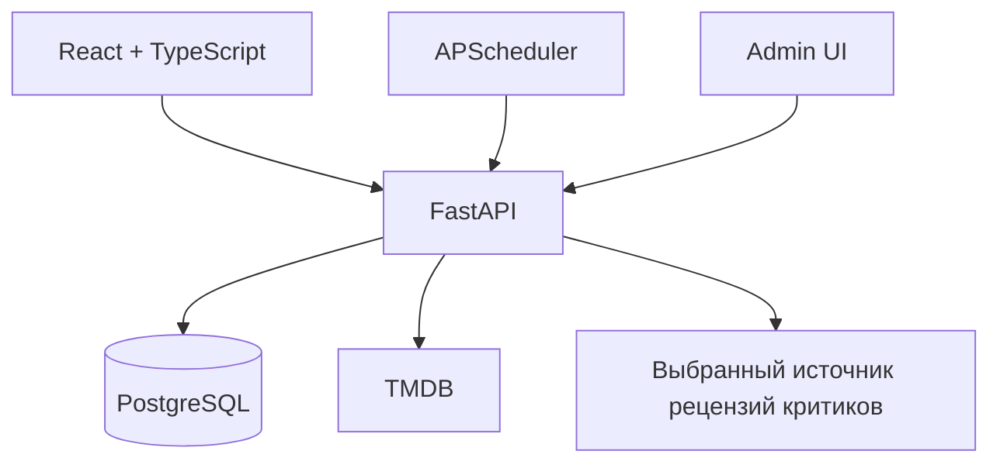

# Архитектура



Клиентская часть обращается только к серверной части. Сервер скрывает ключи внешних служб, нормализует их ответы, сохраняет данные и проверяет права доступа. TMDB используется для каталога фильмов. Автоматический источник рецензий критиков ещё предстоит выбрать; до этого его адрес и формат данных нельзя считать заданными.

Внешние адреса и секретные ключи задаются в настройках окружения сервера. Не следует закреплять IP-адреса служб в приложении: поставщики могут менять адреса и использовать сети доставки содержимого.

При локальном запуске сервисы внутри Docker Compose связываются по именам служб; PostgreSQL использует внутренний порт `5432` и не должен открываться для внешних подключений. Браузер обращается к адресу backend, заданному в настройках клиентской части. Для TMDB серверу нужно исходящее HTTPS-соединение (порт `443`). Точный адрес backend и опубликованные локальные порты зависят от конфигурации запуска.

## Структура

```text
backend/
  app/
  migrations/
  tests/
  requirements.txt
  .env.example
frontend/
  src/
  public/
  package.json
docs/
docker-compose.yml
README.md
.gitignore
```

## Технологии

- Backend: Python 3.13, FastAPI, SQLAlchemy 2, Alembic, Pydantic, HTTPX, APScheduler, pytest.
- Frontend: React, TypeScript, Vite, React Router, Axios, Context API, CSS Modules или CSS.
- Данные: PostgreSQL в общем проекте Supabase либо локальный PostgreSQL в Docker Compose. Доступ к общей базе выполняет backend через Session pooler на порту 5432 с SSL. Таблицы приложения находятся в отдельной схеме `movie_service`; Supabase Auth и Data API для прикладных операций не используются.

## Модули

`auth`, `users`, `movies`, `lists`, `ratings`, `reviews`, `friendships`, `critic_reviews`, `admin`.

## Подключение TMDB

Серверный адаптер `app.integrations.tmdb` использует HTTPX и TMDB API v3. Настройки читаются из `backend/.env`: `TMDB_ACCESS_TOKEN` (API Read Access Token), `TMDB_BASE_URL` (HTTPS, по умолчанию `https://api.themoviedb.org/3/`), `TMDB_TIMEOUT_SECONDS` (по умолчанию 10), `TMDB_LANGUAGE` (по умолчанию `ru-RU`). Токен передаётся только в заголовке Authorization и не выводится в журнал.

Витрина `/movies/discover` и поиск `/movies/search` обращаются к TMDB без БД. Витрина передаёт фильтры, порядок сортировки и номер страницы в TMDB Discover. Открытие `/movies/tmdb/{tmdb_id}` сначала читает локальную карточку, а при отсутствии получает подробности TMDB и атомарно сохраняет фильм, жанры и связи. `/movies` и `/movies/{movie_id}` читают локальную БД. Витрина и поиск возвращают внешний `tmdb_id`, карточка дополнительно возвращает внутренний `id`. Сериалы не запрашиваются, adult-контент исключается. Автоматического обновления карточек и кеширования поисковой выдачи пока нет.

Отсутствие токена не мешает запуску backend; обращение к адаптеру возвращает ошибку конфигурации со статусом 503. Таймауты, сетевые ошибки, ответы TMDB с ошибкой (включая 429) и некорректный формат данных преобразуются в безопасную ошибку 502. Автоматических повторов запросов нет. HTTP-клиент закрывается при выходе из контекста подключения.

Команда `python -m app.integrations.tmdb_check` проверяет доступность поиска без записи в БД. Без токена она завершается с понятным сообщением и кодом 1. Тесты адаптера используют HTTPX MockTransport и не требуют внешних ключей или сети.
