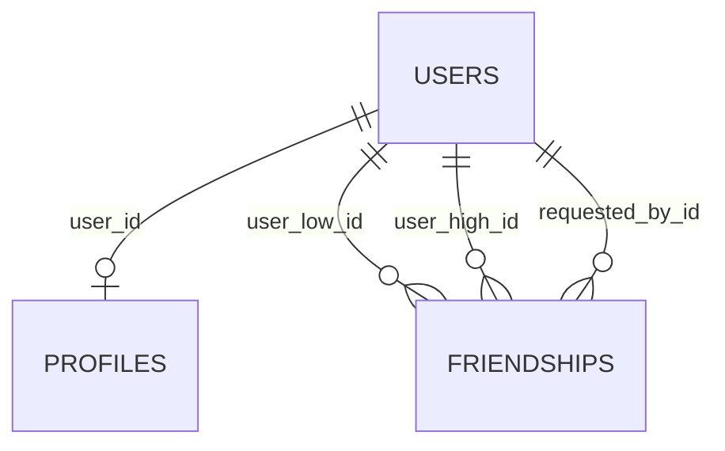
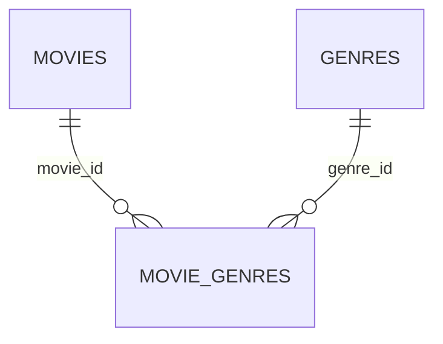
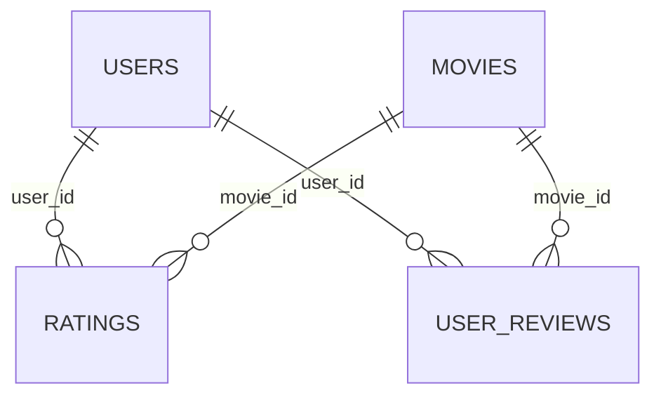
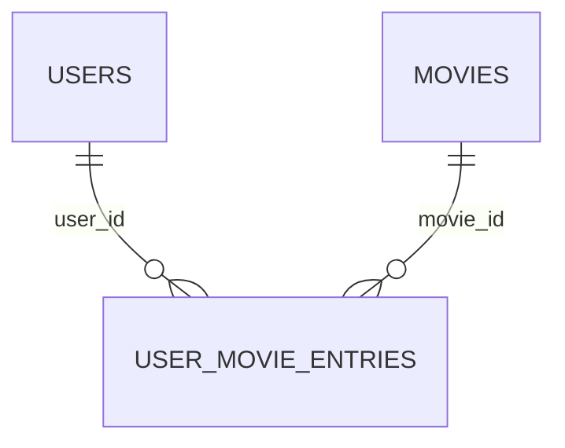
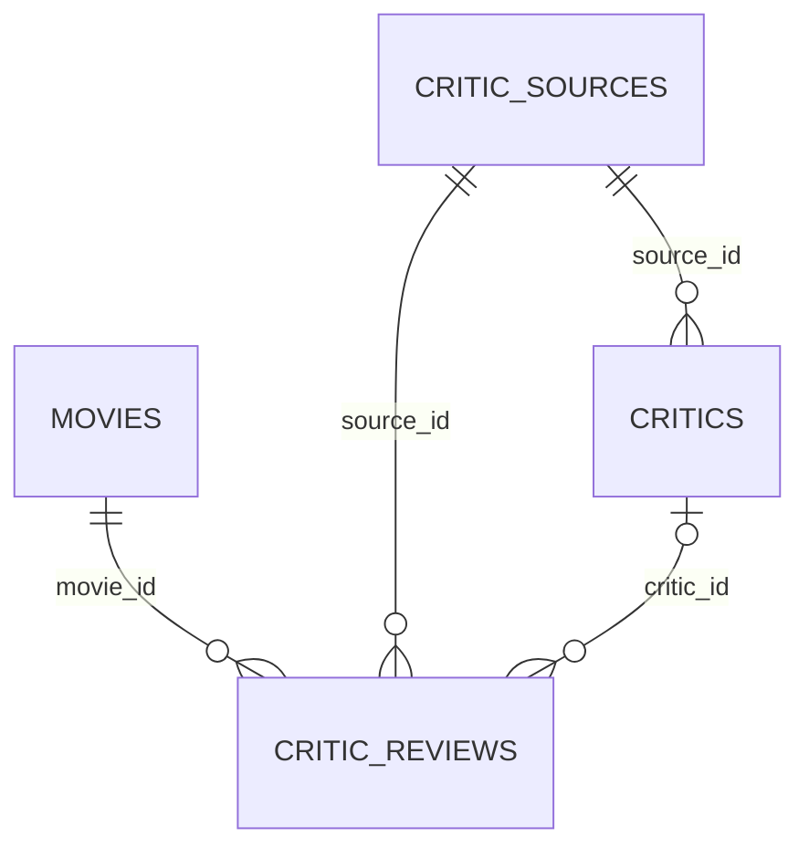

# База данных и ER-схема

## Размещение

PostgreSQL размещается в общем проекте Supabase. Участники подключают локальный backend к одной базе через `backend/.env`. Предметные таблицы и история Alembic находятся в схеме `movie_service`. Служебные схемы Supabase `auth`, `storage`, `public` не управляются миграциями приложения.

Используется собственная авторизация FastAPI и JWT. Таблица `movie_service.users` не связана с `auth.users` Supabase. Подготовленная миграция создаёт 12 предметных таблиц. FR.AUTH.05 (отзыв JWT при выходе) остаётся отложенным; таблица сессий в эту миграцию не входит.

Схему `movie_service` не следует добавлять в Exposed schemas Data API. На всех предметных таблицах включён RLS без клиентских политик. Backend подключается напрямую как владелец таблиц, а прикладные права проверяет FastAPI. Для отдельной ограниченной роли потребуются явные права и RLS-политики.

Настройка: [supabase-setup.md](supabase-setup.md).

## ER-диаграммы

### Пользователи и дружба

PK/FK профиля гарантирует не более одного профиля. Регистрация создаёт пользователя и профиль одной транзакцией, поэтому через штатную регистрацию профиль обязателен.

### Каталог

### Оценки и рецензии

### Списки

### Рецензии критиков

Автор необязателен. Если он указан, составной FK `(critic_id, source_id)` требует совпадения источника автора и рецензии. Запись критика обозначает автора в конкретном издании; совпадение имён само по себе не идентифицирует человека.

## Общие правила

- ID пользователей и все ссылки на пользователей — UUID. Остальные самостоятельные ID — INTEGER Identity.
- События — TIMESTAMP WITH TIME ZONE; приложение передаёт UTC. Дата выхода фильма — DATE.
- `created_at` и начальный `updated_at` задаются серверным `now()`. SQLAlchemy обновляет `updated_at` через ORM; прямой SQL должен обновлять его явно. Триггер не создаётся.
- Username: 4–20 символов, шаблон действующего API, сравнение с учётом регистра. Email одинаково нормализуется через EmailStr при регистрации и входе, без дополнительного приведения всего адреса к нижнему регистру. UNIQUE применяется к сохранённым значениям.
- Python-атрибут `User.hashed_password` соответствует столбцу `users.password_hash`; хранятся Argon2id-хеши. Поля password_confirm в базе нет.
- Среднее пользовательских оценок вычисляется из ratings; при отсутствии оценок среднее отсутствует. Способ сортировки каталога по рейтингу уточняется при реализации каталога.

## Поля

PK — первичный ключ, FK — ссылка. Обязательность указана явно. Значение по умолчанию применяется, если поле не передано.

### `critic_sources`

| Поле | PostgreSQL | Обязательно | Ключ / значение по умолчанию |
|---|---|---|---|
| `id` | `INTEGER` | да | PK; Identity |
| `name` | `TEXT` | да | — |
| `website_url` | `TEXT` | нет | — |
| `language` | `VARCHAR(10)` | нет | — |
| `source_type` | `VARCHAR(20)` | да | по умолчанию `manual` |
| `is_active` | `BOOLEAN` | да | по умолчанию `true` |

- CHECK: `char_length(btrim(name)) > 0`.
- CHECK: `source_type IN ('api', 'manual')`.

### `genres`

| Поле | PostgreSQL | Обязательно | Ключ / значение по умолчанию |
|---|---|---|---|
| `id` | `INTEGER` | да | PK; Identity |
| `tmdb_id` | `INTEGER` | да | — |
| `name` | `VARCHAR(100)` | да | — |

- CHECK: `char_length(btrim(name)) > 0`.
- CHECK: `tmdb_id > 0`.
- UNIQUE: `tmdb_id`.

### `movies`

| Поле | PostgreSQL | Обязательно | Ключ / значение по умолчанию |
|---|---|---|---|
| `id` | `INTEGER` | да | PK; Identity |
| `tmdb_id` | `INTEGER` | да | — |
| `title` | `TEXT` | да | — |
| `original_title` | `TEXT` | нет | — |
| `overview` | `TEXT` | нет | — |
| `release_date` | `DATE` | нет | — |
| `poster_path` | `TEXT` | нет | — |
| `runtime` | `INTEGER` | нет | — |
| `original_language` | `VARCHAR(10)` | нет | — |
| `updated_at` | `TIMESTAMP WITH TIME ZONE` | да | по умолчанию `now()` |

- CHECK: `char_length(btrim(title)) > 0`.
- CHECK: `runtime IS NULL OR runtime > 0`.
- CHECK: `tmdb_id > 0`.
- UNIQUE: `tmdb_id`.
- Дополнительные индексы: `release_date`.

### `users`

| Поле | PostgreSQL | Обязательно | Ключ / значение по умолчанию |
|---|---|---|---|
| `id` | `UUID` | да | PK; по умолчанию `gen_random_uuid()` |
| `username` | `VARCHAR(20)` | да | — |
| `email` | `VARCHAR(254)` | да | — |
| `password_hash` | `TEXT` | да | — |
| `role` | `VARCHAR(20)` | да | по умолчанию `user` |
| `is_active` | `BOOLEAN` | да | по умолчанию `true` |
| `created_at` | `TIMESTAMP WITH TIME ZONE` | да | по умолчанию `now()` |

- CHECK: `role IN ('user', 'admin')`.
- CHECK: `username ~ '^[a-zA-Z0-9]+(_[a-zA-Z0-9]+)*$'`.
- CHECK: `char_length(username) BETWEEN 4 AND 20`.
- UNIQUE: `email`.
- UNIQUE: `username`.

### `critics`

| Поле | PostgreSQL | Обязательно | Ключ / значение по умолчанию |
|---|---|---|---|
| `id` | `INTEGER` | да | PK; Identity |
| `name` | `TEXT` | да | — |
| `source_id` | `INTEGER` | да | FK → `movie_service.critic_sources.id` |
| `profile_url` | `TEXT` | нет | — |

- CHECK: `char_length(btrim(name)) > 0`.
- UNIQUE: `id, source_id`.
- Дополнительные индексы: `source_id`.

### `friendships`

| Поле | PostgreSQL | Обязательно | Ключ / значение по умолчанию |
|---|---|---|---|
| `id` | `INTEGER` | да | PK; Identity |
| `user_low_id` | `UUID` | да | FK → `movie_service.users.id` |
| `user_high_id` | `UUID` | да | FK → `movie_service.users.id` |
| `requested_by_id` | `UUID` | да | FK → `movie_service.users.id` |
| `status` | `VARCHAR(20)` | да | по умолчанию `pending` |
| `created_at` | `TIMESTAMP WITH TIME ZONE` | да | по умолчанию `now()` |
| `updated_at` | `TIMESTAMP WITH TIME ZONE` | да | по умолчанию `now()` |

- CHECK: `user_low_id < user_high_id`.
- CHECK: `requested_by_id IN (user_low_id, user_high_id)`.
- CHECK: `status IN ('pending', 'accepted', 'rejected')`.
- UNIQUE: `user_low_id, user_high_id`.
- Дополнительные индексы: `user_high_id, status`; `user_low_id, status`; `requested_by_id`.

### `movie_genres`

| Поле | PostgreSQL | Обязательно | Ключ / значение по умолчанию |
|---|---|---|---|
| `movie_id` | `INTEGER` | да | PK; FK → `movie_service.movies.id` |
| `genre_id` | `INTEGER` | да | PK; FK → `movie_service.genres.id` |

- Составной PK: `movie_id, genre_id`.
- Дополнительные индексы: `genre_id`.

### `profiles`

| Поле | PostgreSQL | Обязательно | Ключ / значение по умолчанию |
|---|---|---|---|
| `user_id` | `UUID` | да | PK; FK → `movie_service.users.id` |
| `display_name` | `VARCHAR(100)` | нет | — |
| `bio` | `TEXT` | нет | — |
| `avatar_url` | `TEXT` | нет | — |
| `is_private` | `BOOLEAN` | да | по умолчанию `false` |

- CHECK: `bio IS NULL OR char_length(bio) <= 1000`.

### `ratings`

| Поле | PostgreSQL | Обязательно | Ключ / значение по умолчанию |
|---|---|---|---|
| `user_id` | `UUID` | да | PK; FK → `movie_service.users.id` |
| `movie_id` | `INTEGER` | да | PK; FK → `movie_service.movies.id` |
| `score` | `SMALLINT` | да | — |
| `created_at` | `TIMESTAMP WITH TIME ZONE` | да | по умолчанию `now()` |
| `updated_at` | `TIMESTAMP WITH TIME ZONE` | да | по умолчанию `now()` |

- CHECK: `score BETWEEN 1 AND 10`.
- Составной PK: `user_id, movie_id`.
- Дополнительные индексы: `movie_id`.

### `user_movie_entries`

| Поле | PostgreSQL | Обязательно | Ключ / значение по умолчанию |
|---|---|---|---|
| `user_id` | `UUID` | да | PK; FK → `movie_service.users.id` |
| `movie_id` | `INTEGER` | да | PK; FK → `movie_service.movies.id` |
| `list_type` | `VARCHAR(20)` | да | PK |
| `created_at` | `TIMESTAMP WITH TIME ZONE` | да | по умолчанию `now()` |

- CHECK: `list_type IN ('watchlist', 'watched', 'favorite')`.
- Составной PK: `user_id, movie_id, list_type`.
- Дополнительные индексы: `movie_id`; `user_id, list_type`.

### `user_reviews`

| Поле | PostgreSQL | Обязательно | Ключ / значение по умолчанию |
|---|---|---|---|
| `id` | `INTEGER` | да | PK; Identity |
| `user_id` | `UUID` | да | FK → `movie_service.users.id` |
| `movie_id` | `INTEGER` | да | FK → `movie_service.movies.id` |
| `text` | `TEXT` | да | — |
| `contains_spoilers` | `BOOLEAN` | да | по умолчанию `false` |
| `created_at` | `TIMESTAMP WITH TIME ZONE` | да | по умолчанию `now()` |
| `updated_at` | `TIMESTAMP WITH TIME ZONE` | да | по умолчанию `now()` |

- CHECK: `char_length(btrim(text)) > 0`.
- UNIQUE: `user_id, movie_id`.
- Дополнительные индексы: `movie_id, created_at`.

### `critic_reviews`

| Поле | PostgreSQL | Обязательно | Ключ / значение по умолчанию |
|---|---|---|---|
| `id` | `INTEGER` | да | PK; Identity |
| `movie_id` | `INTEGER` | да | FK → `movie_service.movies.id` |
| `critic_id` | `INTEGER` | нет | FK → `movie_service.critics.id` |
| `source_id` | `INTEGER` | да | FK → `movie_service.critic_sources.id`; FK → `movie_service.critics.source_id` |
| `external_id` | `TEXT` | нет | — |
| `title` | `TEXT` | нет | — |
| `excerpt` | `TEXT` | да | — |
| `external_url` | `TEXT` | да | — |
| `language` | `VARCHAR(10)` | да | — |
| `original_score` | `NUMERIC(12, 4)` | нет | — |
| `score_scale` | `NUMERIC(12, 4)` | нет | — |
| `normalized_score` | `NUMERIC(6, 4)` | нет | — |
| `verdict` | `TEXT` | да | — |
| `published_at` | `TIMESTAMP WITH TIME ZONE` | нет | — |
| `moderation_status` | `VARCHAR(20)` | да | по умолчанию `published` |

- CHECK: `moderation_status IN ('pending', 'published', 'rejected')`.
- CHECK: `char_length(btrim(excerpt)) > 0`.
- CHECK: `char_length(btrim(external_url)) > 0`.
- CHECK: `char_length(btrim(verdict)) > 0`.
- CHECK: `(original_score IS NULL AND score_scale IS NULL AND normalized_score IS NULL) OR (original_score IS NOT NULL AND score_scale IS NOT NULL AND normalized_score IS NOT NULL AND score_scale > 0 AND original_score >= 0 AND original_score <= score_scale AND normalized_score BETWEEN 0 AND 10)`.
- UNIQUE: `external_url`.
- UNIQUE: `source_id, external_id`.
- Дополнительные индексы: `critic_id, source_id`; `movie_id, language`.

## Бизнес-правила

- Одна актуальная оценка и не более одной рецензии пользователя на фильм. Оценка и текст независимы.
- Фильм может одновременно быть в watchlist, watched, favorite. Сочетание пользователя, фильма и списка уникально.
- Для дружбы `user_low_id < user_high_id`; пара уникальна; отправитель является её участником. Статусы: pending, accepted, rejected. Переходы и права получателя проверяет backend.
- URL профессиональной рецензии уникален глобально; external_id уникален внутри источника и может быть NULL.
- Числовые поля рецензии критика либо все NULL, либо все заданы. Шкала положительная; исходная оценка в диапазоне 0..score_scale, нормализованная — 0..10. Преобразование выполняет адаптер источника; простое деление применимо только к шкале с нулевой нижней границей. Отсутствие оценки не равно нулю. Вердикт хранится отдельно.
- moderation_status сохранён из исходной схемы: pending, published, rejected; по умолчанию published. Отдельный процесс модерации и новые endpoint'ы эта миграция не реализует.
- Описание профиля ограничено 1000 символами, отображаемое имя — 100; поля необязательны.

## Удаление

| Родитель | Поведение |
|---|---|
| Пользователь | CASCADE на профиль, дружбу, списки, оценки, пользовательские рецензии |
| Фильм | CASCADE на связи жанров, списки, оценки, пользовательские и профессиональные рецензии |
| Жанр | CASCADE на movie_genres; фильмы сохраняются |
| Источник | RESTRICT при наличии критиков или рецензий; для отключения используется is_active |
| Критик | RESTRICT при наличии рецензий |

Правила целостности не добавляют отсутствующие в API пользовательские операции удаления аккаунта или каталога.

## Миграции

Начальная ревизия: `20261101_0001`. История: `movie_service.alembic_version`. Env Alembic создаёт служебную схему при необходимости; миграция создаёт предметные таблицы. Откат удаляет предметные таблицы, оставляя схему и инфраструктуру Alembic.

Автогенерация ограничена схемой movie_service. Используются Direct connection или Session pooler, не Transaction pooler. PostgreSQL session advisory lock предотвращает одновременное выполнение миграций. Применённые миграции не редактируются; изменения оформляются новыми ревизиями и проверяются на отдельной тестовой базе.
